Crafti Survival Edition
=======================

A survival-mode fork of [crafti](https://github.com/Vogtinator/crafti) by Fabian Vogt: 3D Minecraft for TI-Nspire CX calculators running Ndless.
The goal is 1.8.8-style survival play (items, mining, mobs, and difficulty levels) on a calculator.

> **Status:** survival basics are playable: hold-to-mine with tool tiers, block drops, a day/night cycle,
> crafting, furnaces, chests, beds, the smithing table, and lakes to swim in and scoop with a bucket.
> Health and hunger, then mobs, are next.
> Every screenshot below is from the current build.

Screenshots
-----------

| | |
|---|---|
| 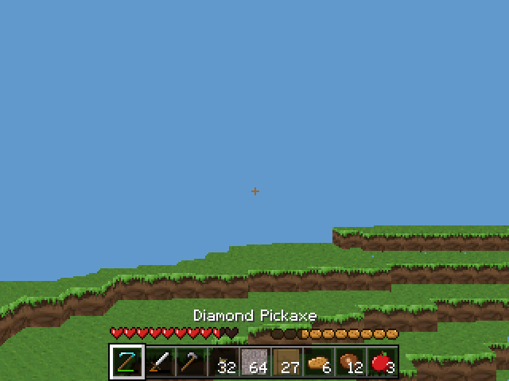 | 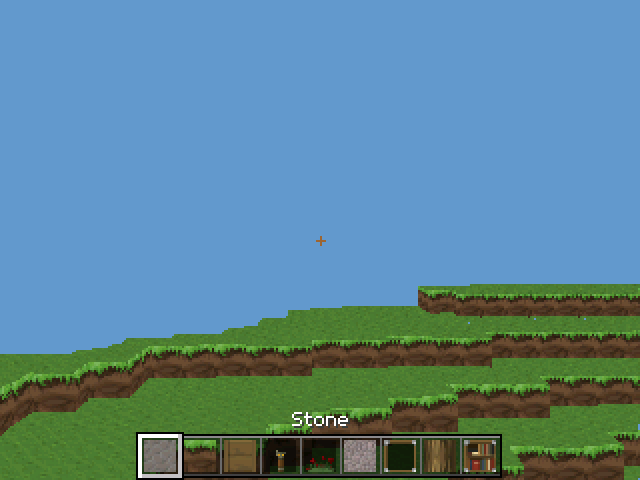 |
| Survival: hearts, hunger and the 9-slot hotbar | Creative: the same hotbar, without hearts and hunger |
| 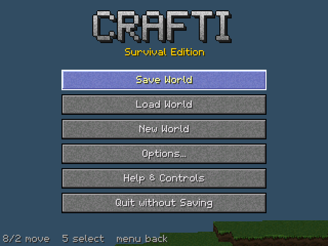 | 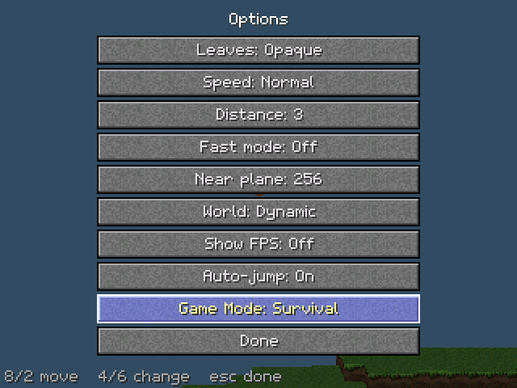 |
| Game menu | Options, with Auto-jump and Game Mode |
| 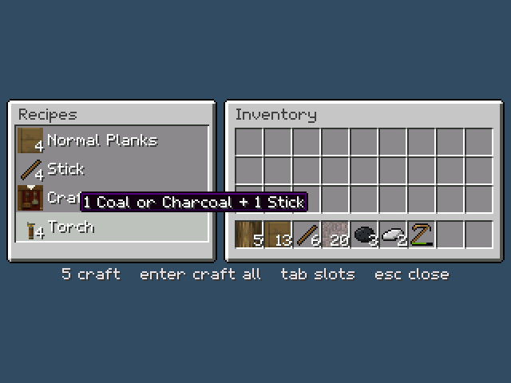 | 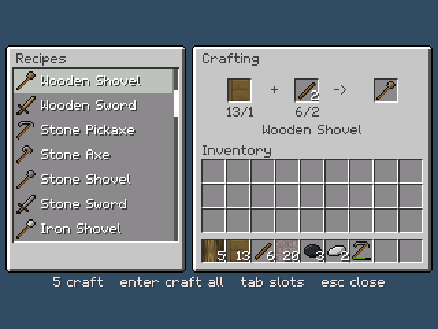 |
| Survival inventory with its 2x2 crafting grid | Crafting table: a 3x3 grid beside the recipe list |
| 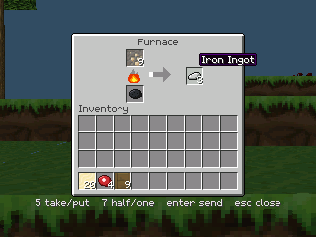 | 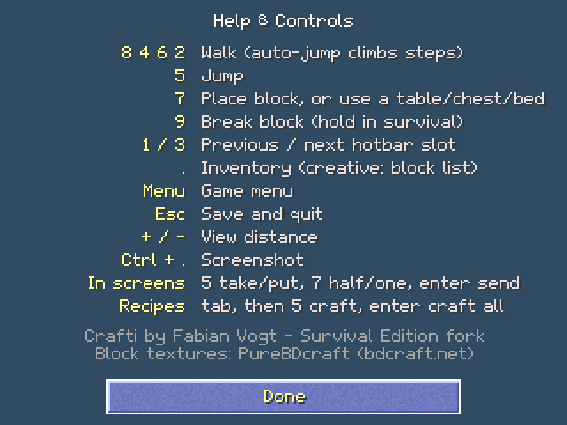 |
| Furnace: input, fuel and output, with the flame and progress arrow | Help & Controls |
| 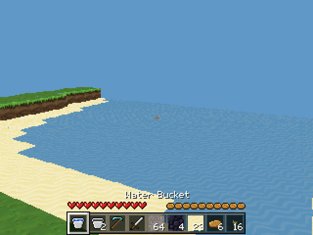 | 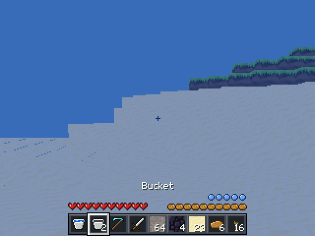 |
| Lakes with sand beaches; buckets carry water | Underwater: the view turns blue and your air runs down |
| 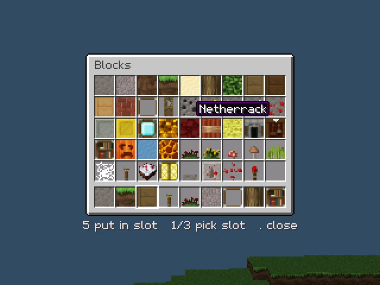 | |
| Creative block list | |

All UI art is original: the pixel font, hearts, hunger, item icons and the title wordmark are drawn by scripts in `tools/` (previews in `tools/preview/`). Nothing is copied from Minecraft or Eaglercraft.

What's new so far
-----------------

- **Eaglercraft-style UI:**
  - a 9-slot hotbar with item counts and wear bars
  - hearts, hunger and air bubbles
  - an inventory screen
  - button menus and a pixel font with drop shadows
- **Items:** 55 items, each with its own icon: tools in six materials, food, ores, materials and buckets.
- **Game mode:** switch between Survival and Creative in Options (locked in Hardcore).
- **Game clock:** fixed 20 ticks per second, independent of frame rate.
- **Entities:** up to 32 entities with physics and collision.
- **Saves:** new save format (v7) with an automatic backup. An unreadable save is never overwritten, and old v6 worlds still load (in creative mode).
- **Lighting:** 8 brightness levels for the coming day/night cycle.
- **Auto-jump:** walks you up one-block steps.
- **Mining:** hold 9 to break blocks at 1.8.8 speeds. Tools have tiers and wear out, and blocks drop items you walk over to collect.
- **World:** a sun and moon with a day/night cycle, more common emeralds, Ancient Debris near bedrock, and saplings that grow into trees.
- **Crafting:** Minecraft's shaped recipes in a 2x2 grid in your inventory and a 3x3 grid at a crafting table (press 7 on one), plus a recipe list beside the grid. Pick a recipe to see its shape in the empty grid, then press 5 to craft it straight from your inventory or 7 to lay it out in the grid. The table makes tools, furnaces, chests, beds, storage blocks and more.
- **Furnaces:** input, fuel and output slots; each item takes 10 seconds. Coal or charcoal smelts 8 items, a log or plank 1.5. Smelts ores to ingots, sand to glass, cobblestone to stone, raw meat, logs to charcoal and Ancient Debris to netherite scrap. Furnaces keep cooking while their chunk is loaded, and while you watch.
- **Chests, beds and the smithing table:** chests hold 27 stacks, beds skip the night and set your spawn, and the smithing table turns diamond tools into netherite.
- **Water:** new chunks have lakes, filled up to sea level, with sand beaches and seabeds. Water follows 1.8.8's rules:
  - **Swimming:** you sink slowly, hold 5 to swim up, and walk at half speed. Push against a low bank to climb out.
  - **Air:** with your head underwater you have 15 seconds of air (the bubbles above your hunger), and the view turns blue.
    Drowning damage comes with health.
  - **Buckets:** three iron ingots in a V at a crafting table. Press 7 with an empty bucket on still water to scoop it,
    and with a water bucket to pour it.
  - **Flowing:** flowing water between two still blocks becomes still (an infinite source). Lava touching water
    turns to obsidian (still lava) or cobblestone (flowing), and lava falling onto water turns it to stone.
  - You aim through water and lava, so you can mine the seabed and build into a lake. Blocks push fluids out.
- **Stress test:** `crafti-stress.tns` shows FPS and ticks per second on the calculator.

Planned
-------

- Health, hunger and damage, including drowning
- Zombies, creepers, skeletons, passive animals and a wandering trader
- Difficulties: Peaceful, Easy, Normal, Hard and Torment, plus a Hardcore switch

Building
--------

See [docs/building.md](docs/building.md). GitHub Actions builds `crafti.tns` and `crafti-stress.tns` on every push (see the **Actions** tab).

Controls
--------

| Key | In the world | In screens |
|---|---|---|
| 8 4 6 2 | Walk (auto-jump climbs steps) | Move the cursor / pick a recipe |
| 5 | Jump (hold in water to swim up) | Take or put down a stack; on the result slot, craft one / in the recipe list, craft one (hold to repeat) |
| 7 | Place block, use a bucket, or use a chest, furnace, crafting table, bed or smithing table | Take half, or put down one / in the recipe list, lay the recipe out in the grid |
| 9 | Break block (hold in survival) | |
| 1 / 3 | Previous / next hotbar slot | Pick the hotbar slot (block list) |
| . | Inventory (creative: block list) | Close |
| enter | | Send a stack to the other section / on the result slot or in the recipe list, craft as many as you can |
| tab | | Switch between the slots and the recipe list |
| menu | Game menu | Back |
| esc | Save and quit | Close |
| + / - | View distance | |
| ctrl + . | Screenshot | |

Limitations
-----------

crafti doesn't use floats, so there will be some graphical inaccuracies.

Credits
-------

Original crafti by [Fabian Vogt (Vogtinator)](https://github.com/Vogtinator/crafti); ticalc.org Program of the Year 2014.
Block textures from PureBDcraft by https://bdcraft.net.
